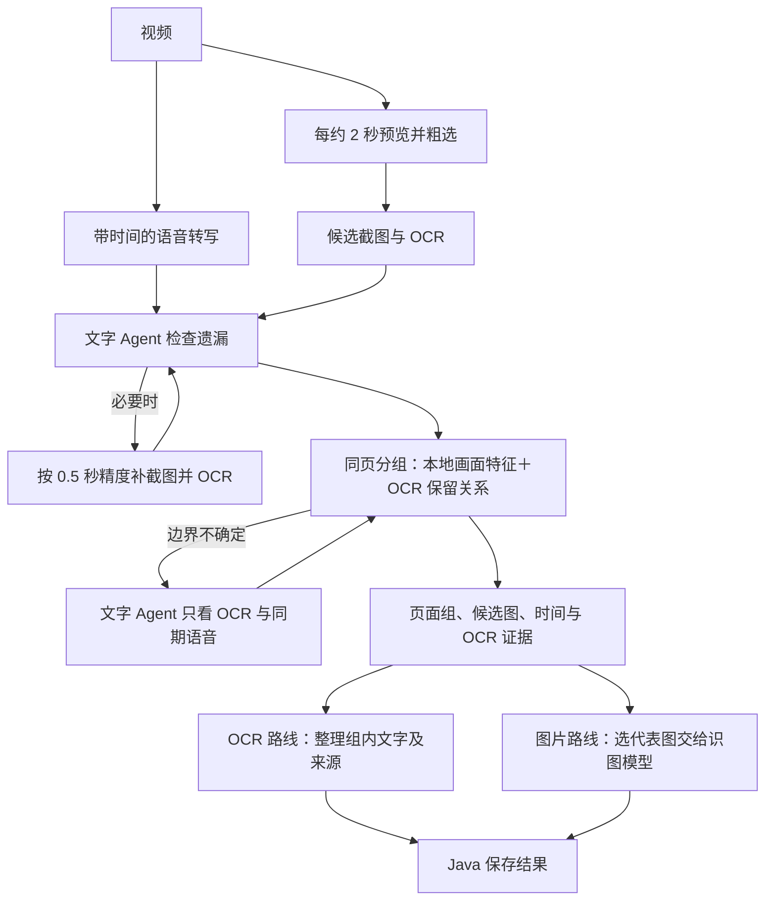

# 课程画面同页合并设计

> 状态：设计稿，尚未实现。日期：2026-09-27。范围是现有 VideoStudy 的候选截图分组、代表图选择及两条视觉结果路线；不包括知识图或错因诊断。

## 1. 目标与当前边界

目标是把 28 秒与 56 秒这类“同一页逐步出现公式”的画面归为一页，同时保留讲解开始位置、每次内容变化的时间和原始依据。两条路线共用“哪些截图属于同一页”的结论：OCR 路线只向文字模型发送 OCR/语音文字；图片路线只把选出的代表截图发送给识图模型。不同例题不能因背景模板相同而误合并。

当前 `agent-python/visual_evidence.py` 约每 2 秒粗看一次画面，候选截图先做 PP-OCRv6；`agent-python/agent_review.py` 用语音与 OCR 文字复核，必要时最多两轮按 0.5 秒时间精度补采；`agent-python/image_understanding.py` 随后逐张发送图片。`analysis.py` 把所有候选画面直接作为独立 `visualEvidence` 返回。**目前没有同页合并，也没有独立的 OCR-only 运行开关。**

## 2. 方案选择

| 方案 | 优点 | 问题 |
| --- | --- | --- |
| 只比较像素变化 | 快，不增加模型调用 | 同模板新题容易误合并；逐步动画容易误拆分 |
| 每对截图都交给大模型 | 能理解页面语义 | 调用多；OCR-only 路线不再纯文字；错误难复现 |
| **本地画面特征＋OCR 保留关系，疑难时用文字 Agent** | 两条路线共用分组；少量疑难才调用模型；不向文字模型发送图片 | 需要真实课程样本调阈值 |

采用第三种。宁可暂时把同一页拆成两组，也不自动把不同题目合成一组；不确定时保留原候选截图和原因。

## 3. 共用流程与两条路线



分组发生在**粗选、OCR 与现有补采全部完成之后，图片理解调用之前**。两条路线共用一次分组判断。第一版保留现有逐帧 `visualEvidence` 和全部候选 JPG，减少的是发给图片模型的图片数量；原视频仍在结果成功保存后删除。

提供每任务 `visualAnalysisMode`：`ocr_only` 运行到页面 OCR 结果为止，绝不构造图片 API 请求；`both` 在同一组结果上追加代表图理解，默认选 `both`。目前的 `ANALYSIS_MODE=transcription` 仍只转写，不进入任一视觉路线。Java 在创建任务时记录所选模式，并在失败重试时沿用，不能把用户选择仅存在前端状态中。不提供伪独立的 `image_only`：当前补采明确依赖 OCR 文字。

上传接口接收可选的 `visualAnalysisMode` 字段；Java 校验为 `ocr_only` 或 `both` 后写入任务记录，再随分析请求传给 Python。旧客户端未传时使用 `both`。Python 返回实际执行的模式，供结果页核对；重试读取任务记录，不重新采用当前默认值。

## 4. 页面边界判断

输入是按 `frameTimeMs` 排序的候选帧，每帧有服务器本地 JPG、OCR 文字块、置信度和多边形。判断当前帧时比较上一帧，也比较当前页面组的稳定锚点，避免 A≈B、B≈C 却把明显不同的 A 与 C 链式合并。

文字先统一全半角、空格和标点；短噪声与全视频反复出现的页眉/Logo 不计入主内容。用模糊文本匹配和相对位置比较计算“前一帧主要文字在后一帧保留多少、增加多少、替换多少”。不能依赖 OCR 数组顺序，因为 PPT 文字可能分散排布。

Python 本地使用 OpenCV 将两帧统一尺寸，比较亮度、边缘和显著变化区域；有轻微位移时先对齐。画面相似仅作辅助：同模板新题可能很像，同页大幅动画可能差异很大。第一版主要面向画面稳定的屏幕录制/PPT；摄像机抖动或人物遮挡明显时降低像素比较的权重。

| 判定 | 证据 | 动作 |
| --- | --- | --- |
| 同页补充 | 题干和关键文字保留，布局稳定，主要是新增公式、批注或渐显 | 加入当前页面组，保留该帧时间和 OCR |
| 新页 | 主体题干或标题被替换，相应区域变化；模板/页眉相同也算新页 | 结束旧组、开始新组 |
| 不确定 | OCR 太少或错误多、空白过渡、手写擦除、画面与文字证据冲突 | 文字 Agent 只看两侧 OCR、时间和同期语音；仍不能确定就分开并记录原因 |

阈值是可配置的起始参数，须由标注样本校准；此前示例中的 `0.7`、`0.3` 不是已验证标准。短暂空白/转场不自动算页面，前后有清晰内容时可标为过渡；字少但持续存在的真实标题页仍保留。课程回看先前 PPT 时，因为时段不同，形成新的页面组，不跨越讲课时序合并。

疑难边界的文字 Agent 每对相邻组最多调用一次，每任务设置总上限；超出上限或返回格式错误时按“不确定、暂分开”处理。它只输出边界决定与引用的 OCR/语音时间，不改写原始 OCR，也不能要求新的图片上传。

## 5. 组内结果

每组保存最早与最后候选帧时间、所有成员帧时间、代表图时间及判定依据。最早候选帧只是**近似出现时间**，不冒充精确翻页时刻；“从老师开始讲”可另关联语音片段起点，不能拿代表图时间替代。

**OCR 路线：**保留原始文字块、位置、分数及来源帧。展示文字按空间位置和出现顺序整理：重复题干选质量较好的一版，后来新增的公式补入；被擦除的早期重要内容仍保留来源时间。数字、公式相互矛盾时不按字数自动择一，而是保留变体和来源供核对。文字 Agent 只收到 OCR 与 ASR，不收到图片。

**图片路线：**在组内选清晰、覆盖内容较多、接近稳定状态且早于下一页的代表 JPG。不能只按 OCR 字数最大选择，否则图表页会吃亏。若一页多阶段出现且后期擦除了早期重要信息，最多选两张互补阶段图并保留各自时间。图片理解挂在页面组；单图失败仅标记该组图片理解失败，不丢弃 OCR 和截图。

例如 28 秒与 56 秒若确实属于同一题，页面组可记录 `firstFrameTimeMs=28000`、成员 `[28000,56000]`，暂选 56 秒为代表图；若后面更完整，则继续比较。前端的一张页面卡片保留“从较早讲解处播放”和“看代表画面”两个不同跳转。

## 6. 数据与接口

`TranscriptResult.visualEvidence` 继续保存逐帧 OCR 与截图时间，兼容历史任务及人工复核。新增可选 `pageGroups`、`transitionFrameTimesMs`、`visualAnalysisMode` 和 `groupingVersion`；历史 JSON 缺失时仍按逐帧展示。新版图片理解挂页面组；旧任务原有的逐帧 `imageAnalysis` 仍能读取。建议页面组结构：

```json
{
  "pageIndex": 1,
  "firstFrameTimeMs": 28000,
  "lastFrameTimeMs": 56000,
  "memberFrameTimesMs": [28000, 56000],
  "representativeFrameTimesMs": [56000],
  "decision": "auto_same_page",
  "decisionReason": "主要题干保留，新增计算过程",
  "ocrLines": [
    {"text": "192－160＝32", "sourceFrameTimeMs": 56000, "sourceBlockIndex": 6}
  ],
  "imageAnalysis": null
}
```

所有时间是视频起点后的整数毫秒。成员与代表时间必须指向同一任务真实保存的截图，不能由模型编造。Java 校验引用并保存结果；图片接口须允许读取页面组引用的截图，不能再只依据旧的逐帧 `imageAnalysis != null` 授权。前端优先显示页面组，可展开原始候选帧；旧任务回退到现有逐帧列表。分组算法及参数记录版本号，便于区分重新计算的结果。

## 7. 失败与资源策略

- 音频任务没有画面，返回空 `pageGroups`，不调用图片模型。
- 边界难判断时分开并标记原因，不需要人工介入才能完成分析。
- OCR 或图片理解失败不删除另一条路线的成功结果；截图仍可回看。整体无法持久化时按现有失败/重试规则处理临时视频。
- 候选 JPG 留在项目 `.local/keyframes/<任务ID>`，MySQL 不存图片二进制。图片模型只接收每组代表图（一般 1 张、特殊情况最多 2 张），不再默认接收全部候选图。正式启用前实测组数、存储、token 和耗时，并设置每任务图片调用上限。
- 用户删除课程时须同步删除截图；当前项目还没有课程删除流程，本设计不把它写成已实现。

## 8. 验收

先**不调用图片 API**，为现有视频的相邻候选帧人工标注“同页/新页/不确定”，再测试分组。样本至少覆盖：28 秒与 56 秒的逐步公式、同模板换例题、低文字标题页、短暂空白、手写添加/擦除以及 PPT 回看。优先核查误合并，同时报告漏合并，不能只报总准确率。

针对讨论中的例子，若 28 秒与 56 秒仍显示同一道题及逐步补出的计算，应合为一组；随后出现另一道题，即使背景模板相同也必须拆组。单凭时间间隔或 OCR 字数不能决定这两个结果。

自动测试覆盖：时间严格递增；每个候选帧恰属一组或被标为过渡；代表帧在本组内；旧任务可读；图片接口只能读取本任务的真实帧；OCR-only 路线不发送图片；图片路线只发送代表图；图片失败仍保留 OCR。用合成逐步动画和同模板新题做回归，再用真实课程抽查。

本设计不把当前双路流程写成已完成端到端验证：29 分钟视频的首次双路运行因图片返回无效 JSON 失败，相关重试和单图失败标记已部署；修复后的整段复测仍待进行。
